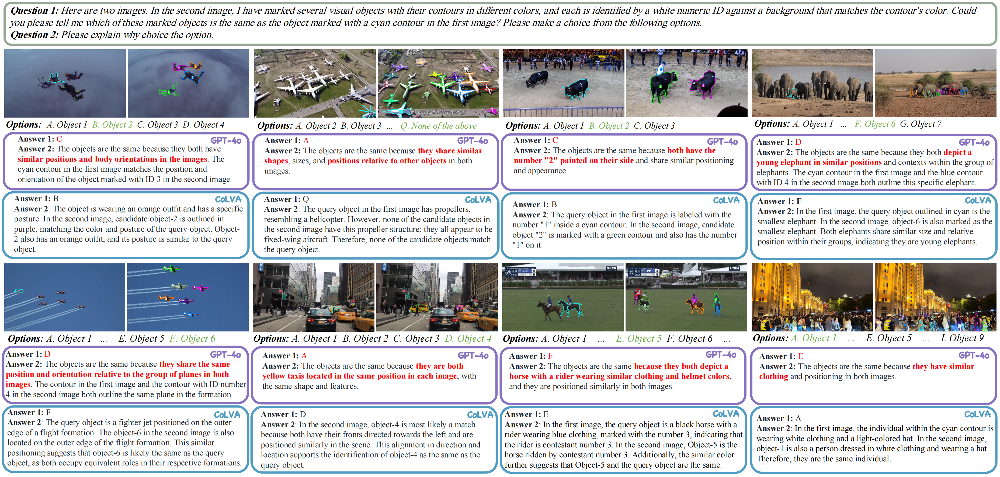

# ¿Son iguales? Explorando las deficiencias en la correspondencia visual de LLMs multimodales (Aceptado por ICCV 2025)

### [Paper](https://arxiv.org/abs/2501.04670) | [Project Page](https://zhouyiks.github.io/projects/CoLVA/) | [MMVM Benchmark](https://huggingface.co/zhouyik/MMVMBench) | [Huggingface](https://huggingface.co/zhouyik/colva_internvl2_4b)




## Índice:
1. [Puesta en marcha](#start)
2. [Benchmark](#benchmarks)
3. [Evaluación](#evaluation)
4. [Entrenamiento](#training)
5. [Licencia](#license)
6. [Cita](#citation)
7. [Agradecimientos](#acknowledgement)

## Puesta en marcha <a name="start"></a>

### Requisitos del entorno
```
# recomendación de Python
conda create --name colva-env python=3.10 -y
conda activate colva-env

# requisitos de transformers
# Al usar InternVL2 como modelo base, transformers>=4.37.2 funciona correctamente.
# Al usar Qwen2VL como modelo base, recomendamos instalar la última versión de transformers:
pip install git+https://github.com/huggingface/transformers

# requisitos de xtuner
pip install -U 'xtuner[deepspeed]'
```

### Modelo preentrenado

Los modelos CoLVA (basados en InternVL2 4b) se pueden encontrar [aquí](https://huggingface.co/zhouyik/colva_internvl2_4b).


## Benchmarks <a name="benchmark"></a>

### Benchmark MMVM

Nuestro Benchmark MMVM está disponible [aquí](https://huggingface.co/zhouyik/MMVMBench). Está especialmente diseñado para medir la capacidad de **emparejamiento visual** de los **LLMs multimodales** mediante VQA. El benchmark está dividido en una carpeta que contiene 1510 casos y un archivo tsv. Cada una de estas carpetas de casos contiene las imágenes y el archivo de anotación del prompt visual involucrado en la conversación correspondiente. El archivo tsv contiene preguntas, opciones y respuestas.
```
├── match_bench
|   |── case_xxx
|   |   |── FRAME00.jpg
|   |   |── FRAME00_ORI.jpg
|   |   |── FRAME00.json
|   |   |── FRAME01_CAND.jpg
|   |   |── FRAME01_ORI.jpg
|   |   └── FRAME01_CAND.json
│   └── ...
└── mllm_match_eval_full.tsv
```


## Evaluación <a name="evaluation"></a>

===RECOMENDADO===
Ahora puedes evaluar MLLMs en nuestro benchmark MMVM utilizando [open-compass/VLMEvalKit](https://github.com/open-compass/VLMEvalKit/pull/1081). El nombre del dataset es MMVMBench, y lo hemos construido como un dataset de VQA multi-imagen. 
Por lo tanto, los resultados difieren de los evaluados con nuestra antigua herramienta de evaluación [VLMEvalKit](https://github.com/open-compass/VLMEvalKit), en la cual construimos MMVMBench como un dataset de preguntas de opción múltiple (MCQ) multi-imagen.

===NO RECOMENDADO===
Hemos construido la herramienta de evaluación **MMVMEvalKit** basándonos en [VLMEvalKit](https://github.com/open-compass/VLMEvalKit). Para evaluar MLLMs en nuestro benchmark MMVM, 
puedes encontrar la versión de desarrollo de nuestra herramienta de evaluación [aquí](https://github.com/zhouyiks/MMVMEvalKit.git).


Antes de ejecutar la evaluación: 

1. Clona nuestro **MMVMEvalKit**.
2. Descarga `match_bench.zip` y `mllm_match_eval_full.tsv` desde [aquí](https://huggingface.co/zhouyik/MMVMBench) y colócalos dentro de la carpeta de **MMVMEvalKit**, luego descomprime `match_bench.zip`.
3. Los requisitos del entorno siguen los de [VLMEvalKit](https://github.com/open-compass/VLMEvalKit).
4. Nota: Tu clave de API de OpenAI debe configurarse en el archivo **.env**:
```
# API de OpenAI
OPENAI_API_KEY=
OPENAI_API_BASE=
```

Para evaluar los MLLMs existentes en el benchmark MMVM, por ejemplo, InternVL2-2B, ejecuta:
```
python run.py --data MMatch --model InternVL2-2B --verbose
```

Para evaluar CoLVA-InternVL2-4B en el benchmark MMVM, descarga los pesos preentrenados desde [aquí](https://huggingface.co/zhouyik/colva_ablation) y ejecuta:
```
python run.py --data MMatch --model colva_internvl2_4b --verbose
```

Para evaluar CoLVA-Qwen2VL-2B en el benchmark MMVM, descarga los pesos preentrenados desde [aquí](https://huggingface.co/zhouyik/colva_ablation) y ejecuta:
```
python run.py --data MMatch --model colva_qwen2vl_2b --verbose
```

Para evaluar CoLVA-Qwen2VL-7B en el benchmark MMVM, descarga los pesos preentrenados desde [aquí](https://huggingface.co/zhouyik/colva_ablation) y ejecuta:
```
python run.py --data MMatch --model colva_qwen2vl_7b --verbose
```

## Entrenamiento <a name="training"></a>

### Procedimiento de entrenamiento

CoLVA consta de tres componentes: un MLLM preentrenado (por ej., InternVL2, Qwen2VL), un experto visual de alta granularidad RADIO y un adaptador RADIO.
El procedimiento de entrenamiento de CoLVA incluye dos etapas: pre-entrenamiento y ajuste fino supervisado (SFT). 
Congelamos el MLLM y RADIO durante la etapa de pre-entrenamiento, centrándonos únicamente en entrenar el Adaptador RADIO. 
Durante la etapa de SFT, congelamos el RADIO, el adaptador RADIO y todos los componentes de InternVL2-4B excepto el LLM. 
El LLM del MLLM se ajusta aplicando LoRA.

### Preparación de datos

Durante la fase de pre-entrenamiento, muestreamos 500k imágenes con etiquetas de segmentación de [SA1B](https://ai.meta.com/datasets/segment-anything/).

Durante la fase de ajuste fino, utilizamos los datos de [LLaVA SFT](https://huggingface.co/datasets/liuhaotian/LLaVA-Instruct-150K/tree/main), [ShareGPT4o](https://huggingface.co/datasets/OpenGVLab/ShareGPT-4o) y nuestros [datos de SFT de MMVM](https://huggingface.co/datasets/zhouyik/MMVMData/tree/main).

### Pre-entrenamiento

Para la etapa de pre-entrenamiento de CoLVA-InternVL2-4B, ejecuta con 1 nodo y 8 procesos: 
```
bash tools/dist.sh train projects/colva/pretrain/internvl2_phi3_4b_radio_align_pretrain.py 8 
```
o ejecuta con DeepSpeed:
```
bash tools/dist.sh train projects/colva/pretrain/internvl2_phi3_4b_radio_align_pretrain.py 8 --deepspeed deepspeed_zero3
```

### Ajuste fino

Para la etapa de ajuste fino de CoLVA-InternVL2-4B, ejecuta:
```
bash tools/dist.sh train projects/colva/finetune/internvl2_phi3_4b_radio_match_sft.py 8
```

**Nota:** Debes establecer `radio_adapter_weight` con la ruta de los pesos del adaptador RADIO preentrenado en el archivo `projects/colva/finetune/internvl2_phi3_4b_radio_match_sft.py`. Por ejemplo,
```
radio_adapter_weight = "./work_dirs/internvl2_phi3_4b_radio_align_pretrain/iter_11792.pth"
```

## Licencia <a name="license"></a>

Este proyecto está bajo la licencia MIT. Consulta [LICENSE](LICENSE) para más detalles.

## Cita <a name="citation"></a>
Por favor, considera citar nuestro trabajo si encuentras este proyecto útil para tu investigación:

```bibtex
@misc{zhou2025sameexploringvisualcorrespondence,
      title={Are They the Same? Exploring Visual Correspondence Shortcomings of Multimodal LLMs}, 
      author={Yikang Zhou and Tao Zhang and Shilin Xu and Shihao Chen and Qianyu Zhou and Yunhai Tong and Shunping Ji and Jiangning Zhang and Xiangtai Li and Lu Qi},
      year={2025},
      eprint={2501.04670},
      archivePrefix={arXiv},
      primaryClass={cs.CV},
      url={https://arxiv.org/abs/2501.04670}, 
}
```

## Agradecimientos <a name="acknowledgement"></a>
- Este trabajo se basa en [InternVL2](https://github.com/OpenGVLab/InternVL) y [Qwen2VL](https://github.com/QwenLM/Qwen2-VL).
